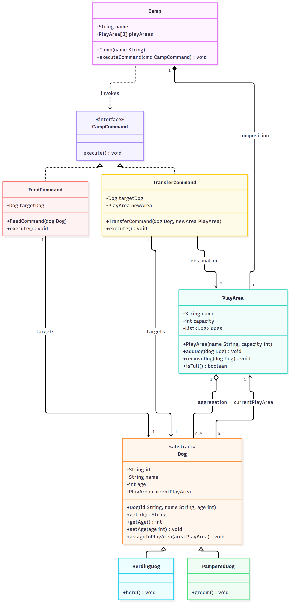

# Dog-Sitting Camp Management System

Object-oriented design exercise: UML class diagram and Java class skeletons.

## UML class diagram



## Design summary

- `Camp` is composed of exactly three `PlayArea` objects (composition) and runs staff actions through `executeCommand(CampCommand)`.
- `PlayArea` aggregates zero or more `Dog` objects, and each `Dog` is in at most one `PlayArea`.
- `Dog` is abstract. `HerdingDog` adds `herd()` and `PamperedDog` adds `groom()`.
- `Dog.id` is `final` with no setter. `Dog.age` must be strictly positive, validated in the constructor and in `setAge`.
- `CampCommand` is implemented by `FeedCommand` and `TransferCommand`, so new commands can be added without changing `Camp` (Open-Closed Principle).

## Structure

```
campdesign/
├── pom.xml
├── diagram.png
├── camp-design.docx / camp-design.pdf   (submission document)
└── src/main/java/campsystem/
    ├── Camp.java
    ├── PlayArea.java
    ├── Dog.java
    ├── HerdingDog.java
    ├── PamperedDog.java
    ├── CampCommand.java
    ├── FeedCommand.java
    └── TransferCommand.java
```
